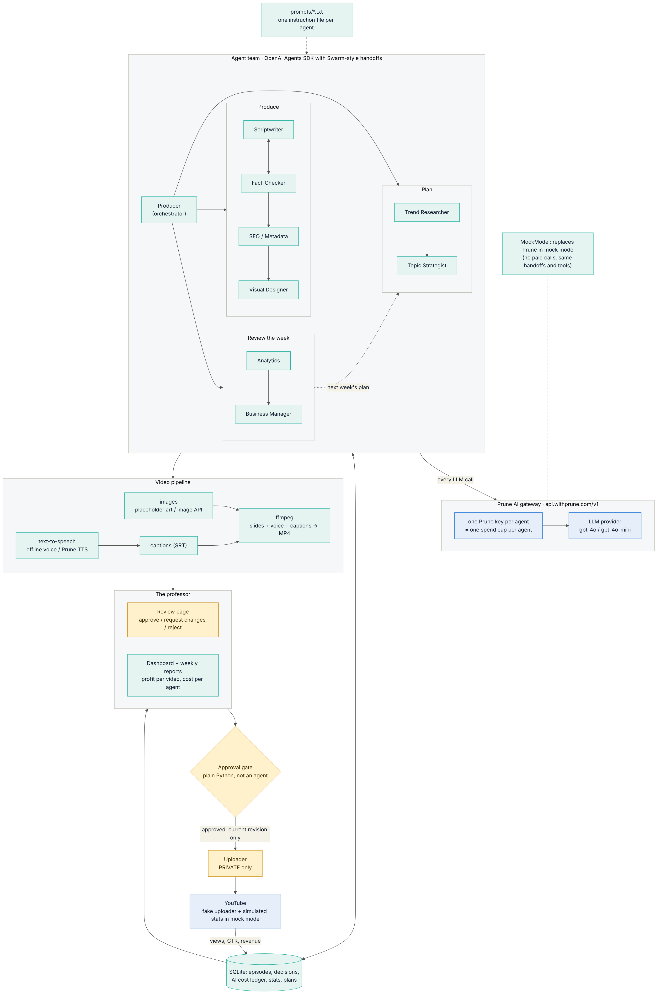
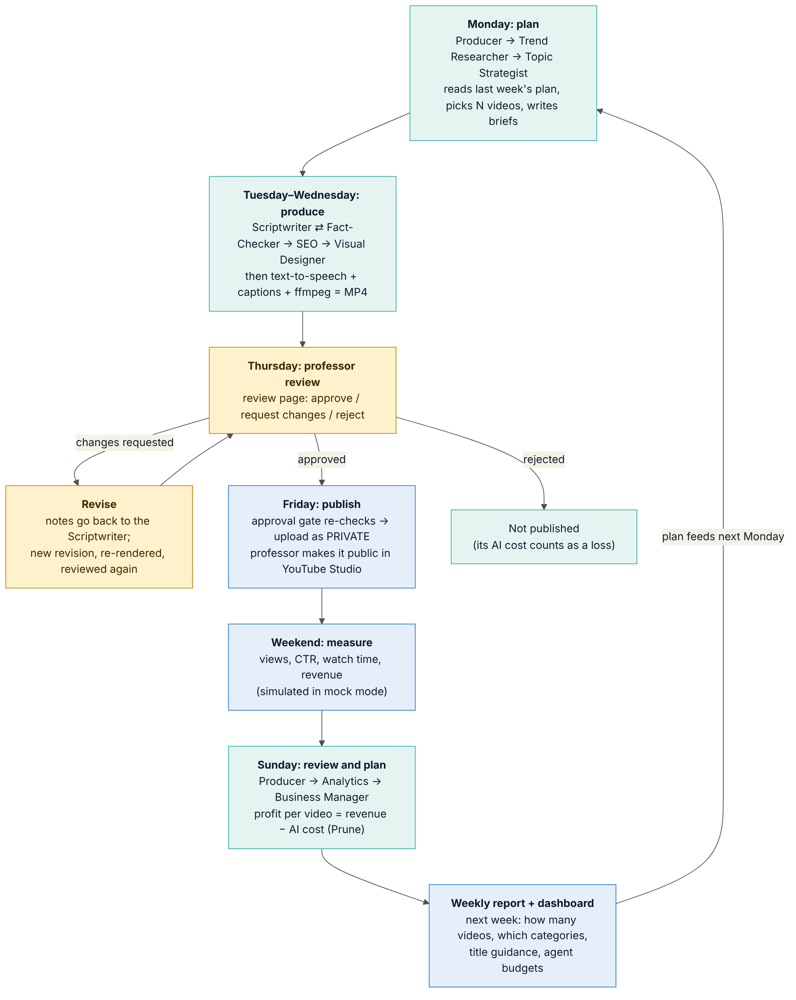
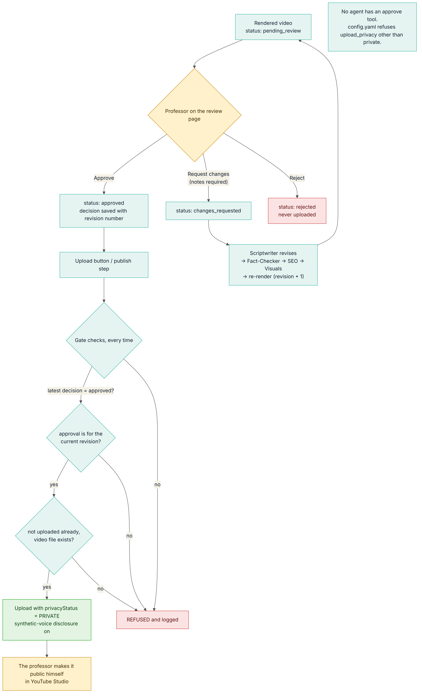

# CAI3303C YouTube Agent System

An agent-based system that runs the business side of a YouTube channel: **"AI and technology explained by a college professor."** The agents research topics, write and fact-check scripts, write titles and thumbnails, make the video (text-to-speech, captions, ffmpeg), track what every agent spends, and plan the next week to make the most profit. **No video is uploaded without the professor's approval, and every upload is private.**

Class project for CAI3303C Natural Language Processing, Miami Dade College.



## How it works

| | |
|---|---|
| Agent framework | OpenAI Agents SDK (`openai-agents`) with Swarm-style handoffs |
| LLM gateway | Every LLM call goes through **Prune** (`https://api.withprune.com/v1`), one Prune key per agent, so each agent has its own spend cap |
| Agent instructions | Loaded from `prompts/<agent>.txt` and never hard-coded |
| Video | Slides (Pillow) + text-to-speech + timed captions, put together with ffmpeg |
| Human in the loop | Review page: **Approve / Request changes / Reject**. The approval gate is plain Python and not an agent, so no LLM can approve anything |
| Business | A cost ledger records every model call (agent, episode, tokens, USD). Profit per video = revenue − AI cost |
| Mode | `mode: mock` in `config.yaml` runs everything with no paid services. `mode: real` switches to Prune, YouTube and paid media APIs |

### The nine agents

| Agent | Job | Hands off to | Prompt |
|---|---|---|---|
| Producer | Reads the stage of the week and routes the work | Trend Researcher, Scriptwriter, Analytics | [prompts/producer.txt](prompts/producer.txt) |
| Trend Researcher | Finds topics with high demand and low competition | Topic Strategist | [prompts/trend_researcher.txt](prompts/trend_researcher.txt) |
| Topic Strategist | Picks this week's videos, following the manager's plan; writes briefs | (end of run) | [prompts/topic_strategist.txt](prompts/topic_strategist.txt) |
| Scriptwriter | Writes the script in the professor's voice, with spots for his own stories | Fact-Checker | [prompts/scriptwriter.txt](prompts/scriptwriter.txt) |
| Fact-Checker | Flags wrong or over-confident claims; sends the script back (2 rounds max) | Scriptwriter or SEO | [prompts/fact_checker.txt](prompts/fact_checker.txt) |
| SEO / Metadata | Titles, description, tags, chapters, pinned comment, synthetic-voice disclosure | Visual Designer | [prompts/seo_metadata.txt](prompts/seo_metadata.txt) |
| Visual Designer | Thumbnail and one visual per scene | (end of run) | [prompts/visual_designer.txt](prompts/visual_designer.txt) |
| Analytics | Reads views, CTR, retention and revenue; explains what worked | Business Manager | [prompts/analytics.txt](prompts/analytics.txt) |
| Business Manager | Profit per video and cost per agent; plans next week (number of videos, categories, title style, budgets) | (end of run) | [prompts/business_manager.txt](prompts/business_manager.txt) |

### The weekly loop



**Profit per video** = revenue to date − (the video's own AI calls + an equal share of the week's planning and review calls). A rejected video earns $0, so its AI cost counts as a loss. The numbers come from the database, never from an LLM.

## Getting started (Windows)

These steps take a teammate from nothing to the system running in mock mode, which is free and needs no keys.

### 1. Check what you have

Open PowerShell and run:

```powershell
py --list          # needs Python 3.11 or 3.12
git --version
ffmpeg -version
```

Install anything that's missing, then close PowerShell and open a new window:

```powershell
winget install Python.Python.3.12
winget install Git.Git
winget install Gyan.FFmpeg
```

### 2. Get the code

```powershell
cd <the folder where you keep your class work>
git clone https://github.com/MCDR-Code/CAI3303C_YouTube_Agents.git
cd CAI3303C_YouTube_Agents
```

### 3. Create and turn on the virtual environment

Use the Python version that `py --list` showed, for example 3.12:

```powershell
py -3.12 -m venv venv
.\venv\Scripts\Activate.ps1
```

You should now see `(venv)` at the start of the line. Type the `.\` at the start of the second command.

If it says running scripts is disabled, run this once, then run the second command again:

```powershell
Set-ExecutionPolicy -Scope CurrentUser RemoteSigned
```

### 4. Install the packages

```powershell
pip install -r requirements.txt
```

### 5. Run two simulated weeks

```powershell
python main.py simulate --weeks 2 --fresh
```

This takes about 2 minutes. The agents plan, write, fact-check and render the videos, a simulated professor approves or requests changes, and the business agents write the weekly reports.

### 6. Open the review page and dashboard

```powershell
python main.py serve
```

Open http://127.0.0.1:5000 in your browser. Press Ctrl+C in PowerShell to stop it.

### 7. Optional: run the tests

```powershell
pip install -r requirements-dev.txt
python -m pytest -q
```

### Next time

You only need to go into the folder, turn the environment back on, and run a command:

```powershell
cd CAI3303C_YouTube_Agents
.\venv\Scripts\Activate.ps1
python main.py serve
```

### If something goes wrong

| Message | Fix |
|---|---|
| `The module 'venv' could not be loaded` | Step 3 didn't run, or the `.\` is missing. Run `py -3.12 -m venv venv`, then `.\venv\Scripts\Activate.ps1` |
| `py` is not recognized | Install Python (step 1), and open a new PowerShell window |
| `No suitable Python runtime found` | Use a version that `py --list` shows, for example `py -3.12` |
| `ffmpeg` not found | Install it (step 1), and open a new PowerShell window |
| `running scripts is disabled` | Run the `Set-ExecutionPolicy` line in step 3 |

No `.env` file is needed in mock mode. Mock mode uses Windows' built-in voices for the narration.

## Commands

| Command | What it does |
|---|---|
| `python main.py week` | Plan, produce and render this week's videos, then stop and wait for the professor |
| `python main.py serve` | Review page, dashboard and weekly reports at http://127.0.0.1:5000 |
| `python main.py revise` | Send videos with "changes requested" back through the agents |
| `python main.py publish` | Upload approved videos as **private** (the gate re-checks every rule) |
| `python main.py close-week` | Stats → Analytics → Business Manager → weekly report and next week's plan |
| `python main.py status` | List every video and its status |
| `python main.py simulate --weeks 2 --fresh` | **Demo only**: whole weeks with a *simulated* professor. Every simulated decision is labeled "SIMULATED professor (demo)" |
| `python -m pytest -q` | Tests: no upload without approval, uploads are private, a revision cancels an old approval, and more |

## Safety rules (enforced in code)

- The uploader calls `approval/gate.py` immediately before every upload. It refuses unless the latest decision is **approved**, the approval is for the **current revision**, the video was not uploaded already, and the file exists.
- `privacyStatus` is always `private`. `config.yaml` refuses any other value. The professor makes a video public himself in YouTube Studio.
- Uploads set YouTube's `containsSyntheticMedia` flag because the narration is a synthetic voice, and the description says so too.
- "Request changes" requires notes. No agent has a tool that can approve.
- Each agent has a local weekly budget (`budgets_weekly_usd`) on top of its Prune key's spend cap.



## Mock mode vs real mode

| Part | Mock (default) | Real |
|---|---|---|
| LLM | `MockModel`: scripted "brains" that make **real** tool calls and **real** SDK handoffs; token use estimated from the real prompt size | Prune, one key per agent (`.env`) |
| Trends and stats | Seeded fake demand data and a channel simulator | YouTube Data API / YouTube Analytics API |
| Images | Labeled placeholder art | Image generation through Prune |
| Voice | Offline (Windows SAPI via pyttsx3, or espeak-ng on Linux) | TTS through Prune |
| Upload | Writes the exact request to `output/uploads/<id>.json` | YouTube Data API `videos.insert`, private |

To go real: copy `.env.example` to `.env` and fill in the nine agent keys plus `PRUNE_KEY_MEDIA`, then `pip install -r requirements-real.txt`, add a Google OAuth client file, and set `mode: real`. Each backend can also be switched on its own under `backends:`. For example, use real Prune LLM calls with the mock channel.

## Folder layout

```
agents_system/   config, Prune gateway, cost tracking, mock LLM, agent tools, registry (handoffs), pipeline
prompts/         one instruction file per agent
tools/           storage (SQLite), trends, channel stats, images, text-to-speech, video (ffmpeg), uploader
approval/        the approval gate and the demo-only simulated professor
webapp/          Flask review page, dashboard, reports
reports/         profit math, SVG charts, weekly report
mock/            fake topics and channel simulator
docs/            diagrams, screenshots, storyboard, sample reports, sample video, run logs
tests/           pytest
```

## Docs for the professor

- Diagrams (`docs/diagrams/`, Mermaid source plus PNG): architecture, weekly loop, handoff sequence, approval gate
- Screenshots (`docs/screenshots/`): terminal run, review queue, review page, a video after a change request, dashboard, weekly report
- Sample storyboard (`docs/storyboard/`): every scene of W01E02 after the professor's change request (PNG and PDF)
- Sample output (`docs/sample_reports/`, `docs/sample_video/`): weeks 1–2 reports, one rendered video with captions, and the exact upload request

## What is tested and what is not

Tested in mock mode: the full handoff graph, the fact-check loop, change requests and revisions, video rendering with captions, the approval gate, private uploads, profit per video, cost per agent, the weekly report and the manager's plan changing the next week.

Written but **not tested** (needs paid keys or a real channel): real Prune calls, Prune TTS and images, YouTube upload, and YouTube analytics.
